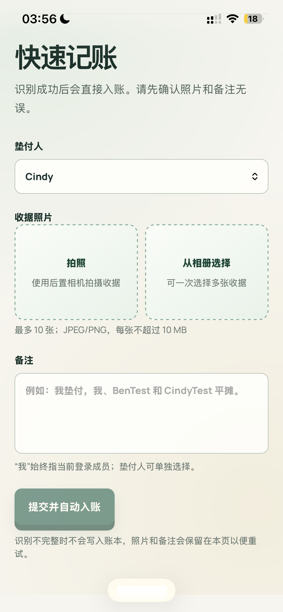
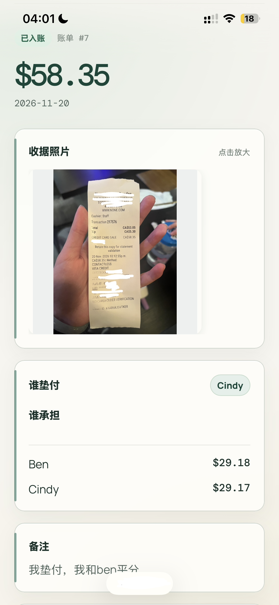
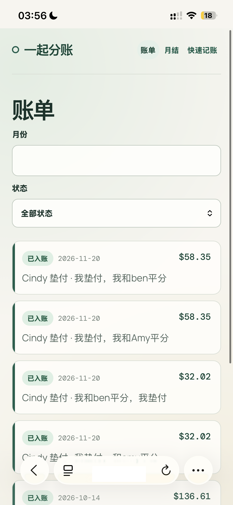
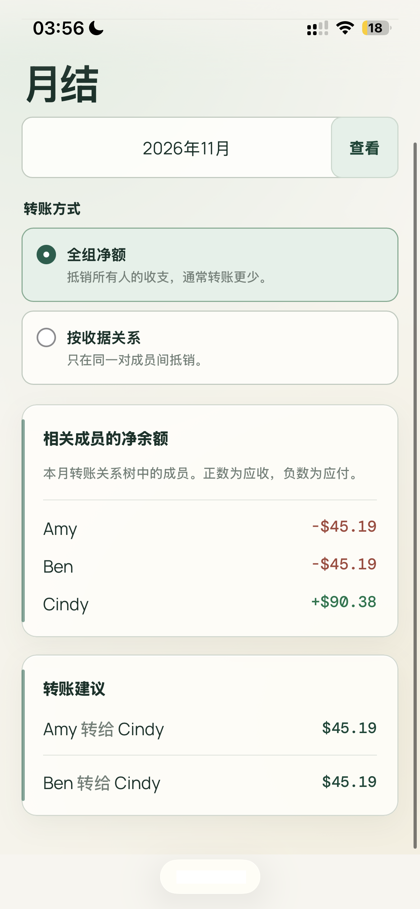

# 一起分账 · Receipt Split

[中文](#中文) · [English](#english)

---

<a id="中文"></a>

## 功能介绍

**一起分账**是一个面向固定好友小组的收据分账工具。拍下收据，写一句备注，系统会读取金额与分账意图，生成可核对的账单，并在月底给出转账建议。

上传一张或多张连续的 JPEG / PNG 收据图片，填写自然语言备注，例如“我垫付，我们三个平摊”。系统会结合当前登录身份理解“我”，并提取日期、实付金额、税前小计、垫付人和分账规则。

商品归属与税、小费、服务费、配送费等附加费用会分别处理：先分配明确的商品金额与余款，再按各自的税前承担比例分摊附加费用。所有金额以 CAD 整数分保存；遇到分币时，系统以稳定规则补足，确保每笔账单的承担总额严格等于实付金额。

识别结果不完整或存在冲突时，账单会保存为待确认草稿，不参与月结。你可以对照原始收据补全信息、调整个人项目和余款平摊成员，预览结果后再确认入账。已入账账单仍可编辑，相关月份的月结会实时重算。

账单列表支持按月份和状态筛选；月结页面展示自己的净余额及转账建议，并提供“全组净额”和“按收据关系”两种结算方式。

## 页面截图
<p align="center">
  
  
</p>

<p align="center">
  
  
</p>

## Easy start

需要已安装 Docker Desktop，以及一个可用的 `OPENAI_API_KEY`。

```bash
git clone <your-repository-url>
cd receipt-split
cp .env.example .env
```

在 `.env` 中填写 API Key：

```dotenv
OPENAI_API_KEY=...
```

启动应用：

```bash
docker compose up --build -d
curl http://127.0.0.1:8080/healthz
```

浏览器打开应用：<http://127.0.0.1:8080/app/>；API 文档：<http://127.0.0.1:8080/docs>。

首次启动会创建成员记录，但不会预设密码。使用维护命令创建或更新登录账号：

```bash
docker compose exec receipt-split receipt-split-admin provision \
  --member-id <member-id> \
  --display-name <display-name>
```

重设密码：

```bash
docker compose exec receipt-split receipt-split-admin reset-password \
  --member-id <member-id>
```

停止服务：

```bash
docker compose down
```

默认服务仅绑定 `127.0.0.1`。如需让手机访问，请先配置 HTTPS 反向代理，再将 `RECEIPT_SPLIT_BIND_HOST` 设为 `0.0.0.0`，并启用 `RECEIPT_SPLIT_COOKIE_SECURE=true`。

## AI 开发模式

本项目采用**评估驱动开发（Evaluation-Driven Development）**与 **AI 结对**的方式迭代。每次改动先明确一个可观察的用户行为和验收条件，再决定实现，而不是先改代码、再寻找理由验证它。

你负责产品判断：定义要解决的真实场景，提供或确认预期结果，查看 AI 提取的原始输出，并对错误提出第一个根因假设。Codex 负责阅读现有实现与测试，提出最小改动方案，完成选定实验并运行相应验证；常规代码审查可交由 Reviewer 完成。

一次典型迭代遵循以下过程：

1. 定义行为与验收，例如“编辑账单时日期可留空，确认后自动使用创建日期；税前小计可留空，并以实付总额计算分账”。
2. 对照已有接口、数据模型、前端交互和测试，确认改动边界；前后端可分轮推进。
3. 实施最小改动，并将验收条件写成回归测试。
4. 分层验证：后端改动运行 pytest，前端改动运行生产构建，涉及部署时再检查服务和页面。
5. 记录改动、运行命令、验证结果和待解决问题，再进入下一轮。

收据提取质量也以评估驱动：固定样例和标准答案只在模型调用后用于评分，绝不发送给模型。每轮只验证一个假设，并记录实际输出、根因假设、实验改动和复测结果；随后运行保留样例，检查改动是否只对单一案例有效。

## 本地开发与技术说明

### 本地环境与验证

```bash
conda create -n receipt-split python=3.12 -y
conda run -n receipt-split python -m pip install -e '.[dev]'
conda run -n receipt-split pytest
```

前端开发与构建：

```bash
cd frontend
npm ci
npm run dev
# 或执行生产构建
npm run build
```

默认 `pytest` 不会调用模型，也不会使用 API 额度。要用固定样例执行真实模型评估：

```bash
conda run -n receipt-split pytest --run-model-evals
```

每次真实提取会在 `runs/<timestamp>-<id>/` 下保留运行元数据、原始模型响应、结构化草稿、耗时和评估结果，便于人工核对与复现。

### 技术栈与数据处理

- 后端：Python、FastAPI、Pydantic、SQLite
- 前端：Vue 3、TypeScript、Vite
- LLM：OpenAI Responses API 与 Structured Outputs
- 部署：Docker Compose
- 测试：pytest、httpx

原始收据以内容寻址文件保存在 `data/objects/`；SQLite 保存图片相对路径、账本数据、确认草稿、模型原始响应和必要审计信息。成员仅能访问自己创建、上传、垫付或参与分摊的收据。`.env`、本地数据库、原始图片和运行产物均不会提交到 Git。

当前版本面向可信好友小组的本地或受控部署；多群组管理、多币种、退款、自动转账、重复收据识别和本地模型提取仍不在当前范围内。

---

<a id="english"></a>

# Receipt Split

[中文](#中文) · [English](#english)

## Features

**Receipt Split** is a receipt-based expense-splitting tool for a trusted, fixed group of friends. Photograph a receipt, add a short note, review the generated bill, and get monthly settlement suggestions.

Upload one or more consecutive JPEG or PNG receipt images and write a natural-language note, such as “I paid; split this among the three of us.” The app uses the signed-in member to resolve “I”, then extracts the receipt date, paid total, pre-fee subtotal, payer, and split rule.

Item ownership is kept separate from tax, tip, service, delivery, and other fees. The app assigns known items and any shared remainder first, then allocates fees in proportion to each member’s pre-fee amount. Amounts are stored as whole Canadian cents; deterministic rounding ensures that individual shares always add up exactly to the paid total.

If extraction is incomplete or contradictory, the receipt remains a pending draft and is excluded from settlement. Participants can compare it with the original receipt, complete or correct fields, adjust individual charges and shared members, preview the result, and then confirm it. Confirmed receipts can still be edited, with affected monthly settlements recalculated immediately.

The receipt list filters by month and status. The settlement page shows your net balance and transfer suggestions, with a choice between group netting and receipt-link settlement.

## Screenshots

<p align="center">
  
  
</p>

<p align="center">
  
  
</p>

## Easy start

You need Docker Desktop and a valid `OPENAI_API_KEY`.

```bash
git clone <your-repository-url>
cd receipt-split
cp .env.example .env
```

Add your key to `.env`:

```dotenv
OPENAI_API_KEY=...
```

Start the application:

```bash
docker compose up --build -d
curl http://127.0.0.1:8080/healthz
```

Open the app at <http://127.0.0.1:8080/app/> and the API documentation at <http://127.0.0.1:8080/docs>.

The first startup creates member records but not passwords. Provision or update a member login with:

```bash
docker compose exec receipt-split receipt-split-admin provision \
  --member-id <member-id> \
  --display-name <display-name>
```

To reset a password:

```bash
docker compose exec receipt-split receipt-split-admin reset-password \
  --member-id <member-id>
```

Stop the service with:

```bash
docker compose down
```

The default service binds only to `127.0.0.1`. To access it from a phone, configure an HTTPS reverse proxy first, then set `RECEIPT_SPLIT_BIND_HOST=0.0.0.0` and `RECEIPT_SPLIT_COOKIE_SECURE=true`.

## AI development practice

This project uses **Evaluation-Driven Development** paired with **AI collaboration**. Every change begins with an observable user behavior and acceptance criteria—not code written first and justified afterwards.

You own product judgment: defining the real scenario, providing or confirming expected outcomes, inspecting raw AI extraction output, and forming the first root-cause hypothesis. Codex reads the existing implementation and tests, proposes the smallest viable change, implements the chosen experiment, and runs relevant validation. Routine code review can be delegated to a Reviewer.

A typical iteration is:

1. Define the behavior and acceptance criteria.
2. Compare the existing API, data model, UI behavior, and tests to establish a change boundary; frontend and backend work may be split into separate rounds.
3. Make the smallest necessary change and encode the acceptance criteria as regression tests.
4. Validate by layer: run pytest for backend work, build the frontend for UI work, and check the running service and page when deployment is involved.
5. Record the change, commands, verification result, and unresolved questions before the next round.

Extraction quality follows the same discipline. Fixed cases and expected answers are used only to score a response after a model call—they are never sent to the model. Each round tests one hypothesis, records the observed output, root-cause hypothesis, experimental change, and retest result, then runs held-out cases to detect overfitting.

## Local development and technical notes

### Environment and checks

```bash
conda create -n receipt-split python=3.12 -y
conda run -n receipt-split python -m pip install -e '.[dev]'
conda run -n receipt-split pytest
```

For frontend development and builds:

```bash
cd frontend
npm ci
npm run dev
# or build production assets
npm run build
```

Regular `pytest` never calls the model or consumes API credits. Run the fixed examples against the live model with:

```bash
conda run -n receipt-split pytest --run-model-evals
```

Every live extraction retains run metadata, the raw model response, parsed draft, timing, and evaluation results under `runs/<timestamp>-<id>/` for review and reproduction.

### Stack and data handling

- Backend: Python, FastAPI, Pydantic, SQLite
- Frontend: Vue 3, TypeScript, Vite
- LLM: OpenAI Responses API with Structured Outputs
- Deployment: Docker Compose
- Testing: pytest and httpx

Original receipt images are stored as content-addressed files in `data/objects/`. SQLite stores image-relative paths, ledger data, confirmed drafts, raw model responses, and essential audit data. Members can access only receipts they created, uploaded, paid, or share. `.env`, local databases, receipt images, and run artifacts are excluded from Git.

The current release targets trusted groups in local or controlled deployments. Multi-group management, multiple currencies, refunds, automatic transfers, duplicate-receipt detection, and local-model extraction remain out of scope.
